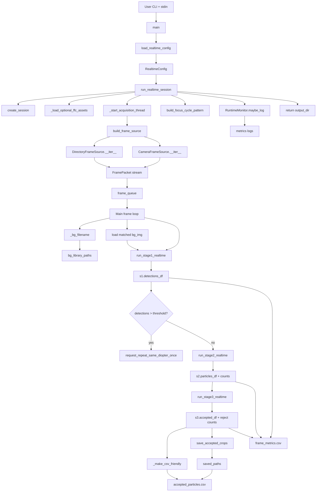

# Realtime module: complete procedural + information-flow chart (`scripts/run_realtime.py`)

This document shows **what runs after you start `scripts/run_realtime.py`**, down to each executed `def`, with:
- where each function's inputs come from,
- what outputs it produces,
- which downstream function consumes those outputs,
- and a short jargon-free explanation of what each function does.

---

## 1) Top-level process flow (human-readable)

START
↓
`main()`
↓
`load_realtime_config(...)`
↓
`run_realtime_session(...)`
↓
`create_session(...)`
↓
`_load_optional_ffc_assets(...)`
↓
`build_focus_cycle_pattern(...)` (for expected ETL background steps)
↓
`_start_acquisition_thread(...)`
↓
`build_frame_source(...)`
↓
`DirectoryFrameSource.__iter__()` **or** `CameraFrameSource.__iter__()`
↓
Producer thread `_run()` puts `FramePacket` into queue
↓
Main loop pops packet, manages background library (`_bg_filename(...)`)
↓
`run_stage1_realtime(...)`
↓
(If too many detections) `request_repeat_same_diopter_once()` and skip Stage2/Stage3 for this frame
↓
`run_stage2_realtime(...)`
↓
`run_stage3_realtime(...)`
↓
`_make_csv_friendly(...)`
↓
`save_accepted_crops(...)` → `_crop_filename(...)`
↓
`RuntimeMonitor.maybe_log(...)`
↓
Finalize, write CSVs, return `output_dir`
↓
END

---

## 2) Def-by-def function catalog (with plain-language descriptions)

## `scripts/run_realtime.py`

### `_SuppressNoisyMeasurementWarnings.filter(record)`
- **Description:** Hides repeated warning messages about invalid orientation/eccentricity so logs stay readable.
- **Inputs:** `record` (`logging.LogRecord`) from Python logging handlers.
- **Outputs:** `bool` (True = keep log line, False = suppress).
- **Output used by:** logging subsystem while printing realtime logs.

### `main()`
- **Description:** Reads CLI options, loads config, asks user for plate/well, then starts the realtime session.
- **Inputs:** CLI args, stdin (`plate`, `well`), config files on disk.
- **Outputs:** `int` exit code (`0`) or raises on invalid config/state.
- **Output used by:** `SystemExit(main())`.

---

## `src/realtime/config.py`

### `_default_black_plate_well_analysis()`
- **Description:** Returns fallback brightness/well settings when pipeline config does not define them.
- **Inputs:** none.
- **Outputs:** default config `dict`.
- **Output used by:** `_resolve_stage1_config(...)`.

### `_resolve_stage1_config(pipeline_cfg, rt)`
- **Description:** Merges shared pipeline Stage-1 settings with realtime settings into one Stage-1 config block.
- **Inputs:** `pipeline_cfg`, realtime section `rt`.
- **Outputs:** `stage1_cfg` dictionary.
- **Output used by:** `load_realtime_config(...)` → `RealtimeConfig.stage1_config`.

### `_must_be_positive(name, value)`
- **Description:** Validates that a numeric config value is strictly greater than zero.
- **Inputs:** field `name`, numeric `value`.
- **Outputs:** none (passes) or raises `ValueError`.
- **Output used by:** `load_realtime_config(...)` validation stage.

### `_must_be_nonnegative(name, value)`
- **Description:** Validates that a numeric config value is zero or above.
- **Inputs:** field `name`, numeric `value`.
- **Outputs:** none (passes) or raises `ValueError`.
- **Output used by:** `load_realtime_config(...)` validation stage.

### `_reject_duplicated_realtime_analysis_keys(rt)`
- **Description:** Prevents old/duplicated analysis keys from being set in the wrong config file section.
- **Inputs:** realtime config dictionary `rt`.
- **Outputs:** none (passes) or raises `ValueError` listing forbidden keys.
- **Output used by:** `load_realtime_config(...)`.

### `load_realtime_config(config_path, pipeline_config_path)`
- **Description:** Loads YAML files, resolves all realtime settings, and returns a fully validated immutable `RealtimeConfig` object.
- **Inputs:** paths to ws runtime config + shared pipeline config.
- **Outputs:** `RealtimeConfig`.
- **Output used by:** `main()` and then `run_realtime_session(...)`.

---

## `src/realtime/orchestrator.py`

### `_start_acquisition_thread(config, out_queue, monitor, acquisition_control)`
- **Description:** Builds the frame source and starts a producer thread that continuously pushes frames into a queue.
- **Inputs:** parsed config, output queue, runtime monitor, acquisition control handle.
- **Outputs:** started `threading.Thread`.
- **Output used by:** `run_realtime_session(...)` for `join()` and lifecycle control.

### `_load_optional_ffc_assets(config)`
- **Description:** Loads flat-field correction images if configured; otherwise returns nothing.
- **Inputs:** `RealtimeConfig.flat_field_dir`.
- **Outputs:** `FlatFieldCorrectionAssets` or `None`.
- **Output used by:** `run_stage1_realtime(...)`.

### `_make_csv_friendly(df)`
- **Description:** Removes heavy image/mask columns so particle rows can be safely written to CSV.
- **Inputs:** accepted particles `DataFrame`.
- **Outputs:** reduced `DataFrame`.
- **Output used by:** CSV append path in `run_realtime_session(...)`.

### `_bg_filename(diopter)`
- **Description:** Converts a diopter value into a safe background image filename.
- **Inputs:** `diopter` float.
- **Outputs:** filename string.
- **Output used by:** background-library save path in `run_realtime_session(...)`.

### `run_realtime_session(config, plate, well)`
- **Description:** Runs the full realtime loop: acquisition, background matching, Stage1/2/3 processing, filtering, saving outputs, and writing metrics.
- **Inputs:** `RealtimeConfig`, `plate`, `well`.
- **Outputs:** session output directory string; persistent files on disk.
- **Output used by:** `main()` for final completion log.

---

## `src/realtime/acquisition.py`

### `_parse_etl_from_filename(path)`
- **Description:** Extracts diopter and focusing distance from image filenames when available.
- **Inputs:** image file `path`.
- **Outputs:** `(diopter | None, focusing_distance_mm | None)`.
- **Output used by:** `DirectoryFrameSource.__iter__()`.

### `build_focus_cycle_pattern(start_dpt, pattern, scan_height_mm, scan_step_um, scan_ratio)`
- **Description:** Builds the ETL stepping sequence (sawtooth or zigzag) used to move focus over time.
- **Inputs:** focus start value and scan geometry parameters.
- **Outputs:** list of diopter setpoints.
- **Output used by:** `run_realtime_session(...)` (expected background step count) and `CameraFrameSource.__iter__()` (live ETL stepping).

### `DirectoryFrameSource.__iter__()`
- **Description:** Reads image files from a directory at target FPS and emits `FramePacket` objects.
- **Inputs:** directory contents, `target_fps`, optional `max_frames`.
- **Outputs:** stream of `FramePacket(frame_index, timestamp_s, image_gray, diopter, focusing_distance_mm)`.
- **Output used by:** acquisition thread producer `_run()`.

### `_to_uint8_grayscale(raw_frame)`
- **Description:** Converts camera frames to grayscale `uint8` format expected by downstream stages.
- **Inputs:** raw camera frame array.
- **Outputs:** `uint8` grayscale image.
- **Output used by:** `CameraFrameSource.__iter__()` before yielding packets.

### `CameraFrameSource.__iter__()`
- **Description:** Grabs frames from Pylon camera, drives ETL focus steps, and emits synchronized `FramePacket` objects.
- **Inputs:** camera/ETL runtime parameters, optional reacquire requests from `AcquisitionControl`.
- **Outputs:** stream of `FramePacket` with image and ETL telemetry.
- **Output used by:** acquisition thread producer `_run()`.

### `build_frame_source(source, ..., acquisition_control)`
- **Description:** Chooses whether acquisition is directory-based or live-camera based and returns the matching source object.
- **Inputs:** source mode and acquisition parameters.
- **Outputs:** `DirectoryFrameSource` or `CameraFrameSource`.
- **Output used by:** `_start_acquisition_thread(...)`.

### `AcquisitionControl.request_repeat_same_diopter_once()`
- **Description:** Requests one extra acquisition at the current diopter, used after overly busy Stage-1 frames.
- **Inputs:** internal counter only.
- **Outputs:** internal state update.
- **Output used by:** consumed in `consume_repeat_same_diopter_request()`.

### `AcquisitionControl.consume_repeat_same_diopter_request()`
- **Description:** Consumes a pending reacquire request and tells camera stepping logic whether to repeat focus.
- **Inputs:** internal counter only.
- **Outputs:** `bool` (repeat or not).
- **Output used by:** `CameraFrameSource.__iter__()` stepping decision.

---

## `src/realtime/stage1_rt.py`

### `_as_uint8(image_float01)`
- **Description:** Converts float image data in `[0,1]` back to `uint8` grayscale.
- **Inputs:** float image array.
- **Outputs:** `uint8` image.
- **Output used by:** `run_stage1_realtime(...)` after flat-field correction.

### `_has_brightness_config_sections(cfg)`
- **Description:** Checks whether all required brightness-adjustment sub-sections are present in config.
- **Inputs:** brightness config dictionary.
- **Outputs:** `bool` completeness flag.
- **Output used by:** `run_stage1_realtime(...)` to enable/disable brightness matching.

### `run_stage1_realtime(fg_img_uint8, bg_img_uint8, frame_index, timestamp_s, config, ffc_assets=None)`
- **Description:** Performs foreground/background prep, subtraction, thresholding, and initial particle detection/refinement for one frame.
- **Inputs:** foreground image, matched background image, metadata, stage1 config, optional FFC assets.
- **Outputs:** `Stage1Result(detections_df)` (with added frame/timestamp/track fields).
- **Output used by:** `run_realtime_session(...)` reacquire gate and Stage-2 input.

---

## `src/realtime/stage2_rt.py`

### `run_stage2_realtime(fg_gray, s1_df, frame_index, stage2_cfg)`
- **Description:** Crops candidate particles, segments each crop, computes quality/morphology features, then rejects low-focus/small-area particles.
- **Inputs:** frame image, Stage-1 detections dataframe, frame index, stage2 config.
- **Outputs:** `Stage2Result(particles_df, pre_threshold_count, rejected_focus_count, rejected_area_count, focus_min, focus_max)`.
- **Output used by:** `run_stage3_realtime(...)` and frame-level logging/metrics.

---

## `src/realtime/stage3_rt.py`

### `run_stage3_realtime(df, config)`
- **Description:** Applies final quality flag filters (artifact and boundary) and returns accepted particles.
- **Inputs:** Stage-2 particle dataframe, Stage-3 filter toggles.
- **Outputs:** `Stage3Result(accepted_df, rejected_artifact_count, rejected_boundary_count)`.
- **Output used by:** persistence (`save_accepted_crops`, CSV append) and runtime counters.

---

## `src/realtime/persistence.py`

### `_crop_filename(session, frame_idx, particle_idx, x, y, ext)`
- **Description:** Builds deterministic crop filenames including session, plate, well, frame, and position.
- **Inputs:** session metadata and particle location fields.
- **Outputs:** filename string.
- **Output used by:** `save_accepted_crops(...)`.

### `save_accepted_crops(df, session, image_format='png', png_compression=3)`
- **Description:** Saves each accepted particle crop image to disk and returns the paths that were written.
- **Inputs:** accepted dataframe, session dirs, image format/compression settings.
- **Outputs:** list of saved image paths.
- **Output used by:** `run_realtime_session(...)` to annotate accepted CSV rows and counters.

---

## `src/realtime/session.py`

### `create_session(config, plate, well)`
- **Description:** Creates output folders for this run and returns session metadata.
- **Inputs:** output root + plate/well IDs.
- **Outputs:** `RealtimeSession`.
- **Output used by:** `run_realtime_session(...)` and persistence naming.

---

## `src/realtime/monitoring.py`

### `RuntimeMonitor.maybe_log(force=False)`
- **Description:** Prints cumulative realtime counters periodically (or immediately when forced).
- **Inputs:** timer state, counters, optional `force` flag.
- **Outputs:** log side-effect only.
- **Output used by:** called throughout `run_realtime_session(...)` and at shutdown.

---

## 3) Information-flow map (where each input comes from, where each output goes)

### A) Entry and configuration lineage
1. User/CLI provides:
   - `--ws-config`, `--pipeline-config` (CLI)
   - `plate`, `well` (stdin)
2. `main()` passes config paths to `load_realtime_config(...)`.
3. `load_realtime_config(...)` reads YAML files, merges/validates, returns `RealtimeConfig`.
4. `main()` passes `RealtimeConfig`, `plate`, `well` into `run_realtime_session(...)`.

### B) Acquisition lineage
1. `run_realtime_session(...)` creates `frame_queue` and `AcquisitionControl`.
2. `_start_acquisition_thread(...)` builds source via `build_frame_source(...)`.
3. Source emits `FramePacket` values with fields:
   - `frame_index`, `timestamp_s`, `image_gray`, `diopter`, `focusing_distance_mm`.
4. Producer `_run()` writes packets into `frame_queue`.
5. Consumer loop in `run_realtime_session(...)` reads packet and routes fields:
   - `packet.image_gray` → Stage1 foreground input and Stage2 raw image input.
   - `packet.diopter` → background keying and CSV metric columns.
   - `packet.timestamp_s` → Stage1 metadata.

### C) Background lineage
1. `packet.diopter` → `_bg_filename(diopter)` to generate file name.
2. `packet.image_gray` saved as ETL-step background until library complete.
3. Library map `bg_library_paths[key]` returns matched bg path for each frame.
4. Loaded `bg_img` becomes Stage1 background input.

### D) Stage processing lineage
1. Stage1:
   - Inputs: `packet.image_gray` (FG), matched `bg_img`, config, FFC assets.
   - Output: `s1.detections_df`.
2. Reacquire branch:
   - If `len(s1.detections_df)` above threshold → `request_repeat_same_diopter_once()`.
   - Stage2/Stage3 skipped for that frame.
3. Stage2:
   - Inputs: `packet.image_gray`, `s1.detections_df`, stage2 cfg.
   - Output: `s2.particles_df` + rejection counters/ranges.
4. Stage3:
   - Inputs: `s2.particles_df`, Stage3 filter toggles.
   - Output: `s3.accepted_df` + artifact/boundary rejection counters.

### E) Persistence + metrics lineage
1. `s3.accepted_df` → `_make_csv_friendly(...)` → append to `accepted_particles.csv`.
2. `s3.accepted_df` → `save_accepted_crops(...)` → `saved_paths`.
3. `saved_paths` mapped back into accepted CSV as `saved_crop_path`.
4. Per-frame counters and stage counts become rows in `frame_metrics.csv`.
5. Runtime counters update `RuntimeMonitor`; `maybe_log()` emits aggregated telemetry.

### F) Return lineage
1. `create_session(...)` creates `session.output_dir`.
2. `run_realtime_session(...)` returns that `output_dir`.
3. `main()` logs completion path and exits `0`.

---

## 4) Optional graph-ready view (Mermaid)

If your Markdown renderer supports Mermaid, this block renders as a real directed graph.



---

## 5) How to convert this Markdown into a real graph

### Option A — Render directly in VS Code (fastest for iteration)
1. Install the extension **"Markdown Preview Mermaid Support"**.
2. Open `docs/realtime_procedural_flowchart.md`.
3. Open Markdown preview (`Ctrl+Shift+V` / `Cmd+Shift+V`).
4. Confirm the Mermaid block in section 4 renders as a flowchart.
5. Export the preview to PDF if needed (Command Palette → `Markdown: Print current document to HTML` then print/save as PDF).

**Best when:** you want quick visual checks while editing.

### Option B — Render in GitHub/GitLab (no local tooling)
1. Commit and push the markdown file.
2. Open the file in the web UI.
3. Verify the Mermaid fenced block renders.
4. Use browser print/export for a snapshot, or keep it as live, versioned docs.

**Best when:** your team reads docs in the repository web UI.

### Option C — Export deterministic SVG/PNG via Mermaid CLI
This gives a real image artifact you can embed in slides, docs, and reports.

1. Save the Mermaid block to a standalone file, for example `realtime_flow.mmd`.
2. Install Mermaid CLI (one-time):
   - `npm install -g @mermaid-js/mermaid-cli`
   - or run without global install: `npx @mermaid-js/mermaid-cli ...`
3. Render SVG:
   - `mmdc -i realtime_flow.mmd -o realtime_flow.svg`
4. Render PNG:
   - `mmdc -i realtime_flow.mmd -o realtime_flow.png -w 2200 -H 1400`
5. (Optional) Use a custom Mermaid config for theme/layout:
   - `mmdc -i realtime_flow.mmd -o realtime_flow.svg -c mermaid-config.json`

Example `mermaid-config.json` knobs to tune:
- `theme` (`default`, `neutral`, `dark`, `forest`)
- `flowchart.curve` (`basis`, `linear`, `cardinal`)
- `fontFamily`, `fontSize`
- `securityLevel` (typically `strict`)

**Best when:** you need stable, reproducible exported graphics for publication.

### Option D — Move to diagrams.net (draw.io) for manual polishing
1. Import Mermaid text (or paste graph structure).
2. Apply manual layout adjustments (grouping, colors, labels).
3. Export to SVG/PDF/PNG.

**Best when:** you want presentation-quality styling beyond auto-layout.

### Practical workflow recommended for this repo
1. Keep section 4 Mermaid in `docs/realtime_procedural_flowchart.md` as source-of-truth.
2. Generate `SVG` in CI or release process using Mermaid CLI.
3. Commit the SVG next to the markdown for viewers that do not render Mermaid.
4. If flow changes, update Mermaid first, then regenerate SVG from the same source.

### Common issues and fixes
- **Graph does not render in Markdown preview:** ensure the code fence starts with ```` ```mermaid ```` and closes correctly.
- **`mmdc` command not found:** use `npx @mermaid-js/mermaid-cli -i realtime_flow.mmd -o realtime_flow.svg`.
- **Labels overlap:** increase canvas (`-w`, `-H`), split very dense nodes, or switch to left-to-right graph (`flowchart LR`).
- **Team viewer lacks Mermaid support:** commit both the markdown and a generated SVG.

### If Mermaid cannot be used
- Keep sections **(1)** and **(3)** as canonical textual flow.
- Convert section **(3)** to Graphviz DOT (node = def, edge = data flow) and render with:
  - `dot -Tsvg realtime_flow.dot -o realtime_flow.svg`


---

## 6) Note about modules not on active execution path

`src/realtime/background_buffer.py` (`BackgroundBuffer`, `StepMatchedBackgroundBuffer`) exists but is **not used by current `run_realtime_session(...)`**, which uses a fixed ETL-step `bg_images` library captured at startup.
